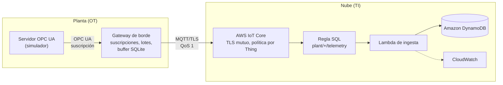

# Arquitectura

Este archivo es el resumen. Las vistas completas están en [`docs/architecture/`](architecture/):

| Vista | Contenido |
|---|---|
| [01 Contexto y contenedores](architecture/01-contexto-y-contenedores.md) | Alcance, contenedores y responsabilidades |
| [02 Despliegue](architecture/02-despliegue.md) | Recursos de AWS, infraestructura como código y entornos |
| [03 ISA-95 e IEC 62443](architecture/03-isa95-e-iec62443.md) | Niveles, zonas, conductos y brechas de seguridad |
| [04 Escenarios de calidad](architecture/04-escenarios-de-calidad.md) | Los 11 atributos con su evidencia |
| [05 Riesgos](architecture/05-riesgos.md) | Registro de riesgos |
| [06 Interfaces y datos](architecture/06-interfaces-y-datos.md) | Mensajes, esquema de DynamoDB y configuración |

La figura de arquitectura está en [`docs/figures/architecture.png`](figures/architecture.png) y se
regenera con `uv run --with pillow python docs/figures/make_architecture_figure.py`.

## Vista de contexto (ISA-95)

## Flujo de datos

1. El lector OPC UA recibe cambios de valor por suscripción (cada 500 ms).
2. Cada cambio se convierte en una `Reading` con valor numérico, instante de origen y calidad.
3. El agrupador forma lotes de hasta `GATEWAY_BATCH_SIZE` lecturas o cada `GATEWAY_FLUSH_INTERVAL_S`.
4. Cada lote se guarda en SQLite antes de intentar enviarlo.
5. El reenviador publica una ventana de mensajes en vuelo con QoS 1 y borra del buffer solo los confirmados (PUBACK).
6. La regla de IoT Core invoca la Lambda, que escribe un item por lectura buena en DynamoDB (valor y latencia de ingesta).

## Observabilidad y medición

- La Lambda emite en cada invocación un registro EMF (Embedded Metric Format) con
  `ReadingsWritten`, `ReadingsRejected` e `IngestLatencyMs`; CloudWatch lo convierte en
  métricas del espacio `ScadaIot` y calcula percentiles sin llamadas adicionales a su API.
- La latencia de ingesta es `hora de la Lambda - ts_ms de origen`, por lo que exige relojes
  sincronizados (`loadtest.clock_check`).
- El tamaño de la cola local es visible en el log del gateway y en el buffer SQLite.

## Decisiones

Ver [docs/adr](adr): almacenamiento y reenvío, lotes en el borde, uso de Lambda como puente hacia DynamoDB, método de
medición y región de despliegue.
