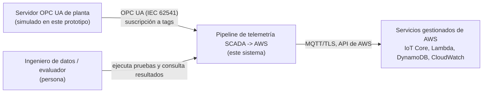
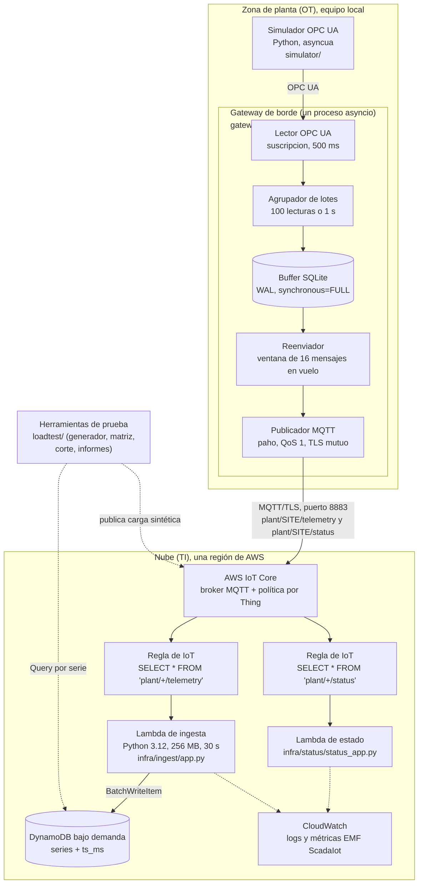

# Vista de contexto y de contenedores

Notación C4 simplificada con diagramas Mermaid (se renderizan en GitHub).

## Contexto

El sistema transporta telemetría de tags OPC UA desde una planta hacia AWS y la deja almacenada para análisis. **No hay
aplicación consumidora de los datos** (tableros, analítica): los únicos lectores de DynamoDB son los scripts de
medición de `loadtest/`.

## Contenedores

| Contenedor | Responsabilidad | Tecnología | Código |
|---|---|---|---|
| Simulador OPC UA | Exponer N tags con rampas, senoidales y estados | Python, asyncua | `simulator/` |
| Gateway de borde | Leer, agrupar, persistir y publicar con confirmación | Python, asyncio, SQLite, paho-mqtt | `gateway/` |
| AWS IoT Core | Autenticar al dispositivo y enrutar mensajes | Servicio gestionado | `infra/template.yaml` |
| Lambda de ingesta | Validar lecturas, medir latencia y escribir idempotente | Python 3.12 | `infra/ingest/app.py` |
| Lambda de estado | Convertir el latido del gateway en métricas (sin acceso a DynamoDB) | Python 3.12 | `infra/status/status_app.py` |
| DynamoDB | Almacenar un item por lectura | Servicio gestionado | `infra/template.yaml` |
| Alarmas y panel | Avisar de errores, latencia alta, cola grande y gateway caído | CloudWatch, SNS | `infra/template.yaml` |
| Herramientas de prueba | Carga, medición, cortes y verificación | Python, boto3 | `loadtest/` |

Las decisiones que dan forma a estos contenedores están en los [ADR](../adr/).
