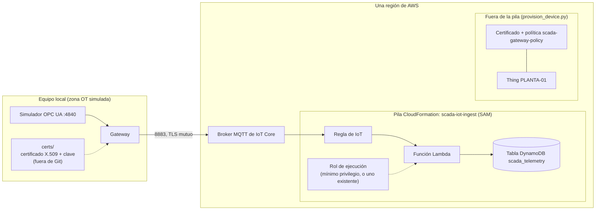

# Vista de despliegue

## Qué se despliega y cómo

- **Infraestructura como código:** `infra/template.yaml` (SAM), desplegada con `infra/deploy.ps1`. Un único comando
  crea la tabla, la función, el rol y la regla.
- **Fuera de la pila:** el Thing, el certificado y la política los crea `infra/provision_device.py` por dispositivo.
  `sam delete` **no** los elimina.
- **Parámetros de la plantilla:** `TableName` (por defecto `scada_telemetry`) y `ExecutionRoleName`. Vacío, SAM crea
  un rol que solo permite escribir en la tabla; con un valor reutiliza un rol existente.
- **Cuotas que condicionan el diseño** (documentación de AWS): 100 publicaciones por segundo por conexión en IoT
  Core, y 4,000 escrituras por segundo sostenidas en una tabla DynamoDB bajo demanda nueva. Ver
  [riesgos](05-riesgos.md).

## Entorno utilizado

| | Cuenta de pruebas |
|---|---|
| Región | us-east-2 (la única permitida por una política de organización) |
| Rol de la Lambda | Creado por SAM, mínimo privilegio |
| Timestream / InfluxDB | LiveAnalytics bloqueado; InfluxDB, según la consola, exige plan de pago |
| Plan | Gratuito, con créditos que caducan el 16 de mayo de 2027 |

El contexto y la decisión están en el [ADR 0005](../adr/0005-region-de-despliegue.md).
