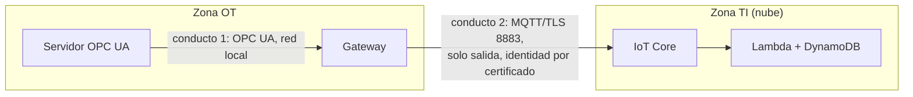

# ISA-95 e IEC 62443

## Correspondencia con los niveles de ISA-95

| Componente | Nivel ISA-95 | Estado en el prototipo |
|---|---|---|
| Simulador OPC UA | 0 y 1 (emulado) | Simula sensores y control; no hay equipos reales |
| Gateway de borde | 2 y 3 (frontera) | Implementado: lee de la planta y publica hacia la nube |
| IoT Core y regla | Frontera OT-TI | Implementado |
| Lambda y DynamoDB | 3 y 4 | Implementado: ingesta y almacenamiento |
| CloudWatch | Transversal | Logs y métricas de la Lambda; el gateway solo registra en su log local |

## Zonas y conductos

IEC 62443 propone agrupar activos en **zonas** y comunicarlas solo por **conductos** controlados. El prototipo adopta
ese principio como criterio de diseño:

- **Solo conexiones de salida desde la planta:** el gateway inicia la conexión MQTT y la planta no abre puertos de
  entrada hacia Internet. La prueba de corte lo aprovecha: bloquear el puerto de salida 8883 basta para
  incomunicar la zona.
- **Identidad por dispositivo:** certificado X.509 propio y política de mínimo privilegio. Verificado
  experimentalmente: IoT Core rechaza publicar en el tema de otro sitio y conectar con un identificador de cliente
  ajeno (`infra/check_policy.py`).
- **Autonomía ante cortes:** el buffer local permite que la planta siga operando sin la nube (ver
  [ADR 0001](../adr/0001-store-and-forward-en-el-borde.md)).

## Lo que este prototipo NO hace

No se declara conformidad con IEC 62443 ni se evalúan niveles de seguridad (SL). Las brechas conocidas:

- El servidor OPC UA simulado **no cifra el transporte** ni usa certificados de aplicación.
- No hay segmentación de red real: zona OT y zona TI son procesos en un mismo equipo.
- No hay rotación de certificados ni inventario de activos.
- El gateway no se endureció (usuario, sistema de archivos, actualizaciones).
- La política de IoT limita el tema, pero no hay monitoreo de intentos rechazados.
